# 1 项目说明

本实验继续设计实验一选定的**校园二手交易系统**。系统面向本校学生，提供商品发布与审核、公开查询、预约、线下交付确认、举报处理、站内通知和统计查询。管理员负责审核商品、处理举报和查看全局操作日志。第一版不做在线聊天、支付、物流、退款或赔付。本文的设计依据是实验一的 `requirements.md`（REQ-001—REQ-027）；学校邮箱域名和测试服务器配置仍待学校确认，界面和图中不写死这些参数。

本次交付的是可供后续实现的设计原型，不宣称系统已经开发或通过性能测试。UI 中的商品、时间、价格和姓名是演示数据；示例联系方式只用于展示访问控制规则。

## 1.1 主要功能与模块

| 模块 | 对应需求 | 主要职责 |
|---|---|---|
| 账号与权限 | REQ-001、002、019、022 | 学校邮箱验证、登录、服务端鉴权、联系方式按现态读取。 |
| 商品与审核 | REQ-003—007、010 | 草稿、提交、审核、发布、修改重审、下架和组合查询。 |
| 预约与交易 | REQ-008—014、016、023、024 | 唯一有效预约、请求幂等、卖家处理、取消、到期、买家确认完成。 |
| 举报处理 | REQ-015 | 举报提交、管理员判定、合并结案及并发状态核对。 |
| 通知 | REQ-013、018 | 业务事件消息、12 小时进度提醒和已确认预约到期前 24 小时提醒。 |
| 统计与日志 | REQ-017、020 | 按预约价格快照统计已完成交易、检索只追加操作日志。 |

# 2 架构与 UML 设计

## 2.1 模块划分及理由

前端分为商品浏览、卖家工作区、买家预约和管理员工作台，但统一通过 API 网关进入后端。网关先识别身份，具体模块再检查资源归属和当前状态。这样即使有人绕开页面直接调用接口，也不能通过改编号访问别人的非公开数据。

商品、预约和举报分别由业务模块处理，但涉及同一件商品的状态变更必须进入同一数据库事务。预约成功时同时创建预约并把商品转为“已预约”；举报确认违规时同时核对商品现态、下架商品并终止有效预约。并发请求以先成功提交的事务为准，后来的操作重新读取现态，不能覆盖已完成交易。通知处理已提交的业务事件；统计按已完成预约查询数据库，两者都不参与核心交易事务。第一版可部署为一个后端应用中的逻辑模块；后续需要扩展时再拆分服务，避免过早引入跨服务事务。

拟采用关系数据库保存用户、商品、预约、举报、请求回执、通知和日志。设计层面设置学校邮箱唯一约束、`(账号编号, 请求编号)` 唯一约束、商品版本号；创建预约时锁定商品并检查当前有效预约，数据库还须约束“同一商品至多一条有效预约”。商品状态和预约状态分别保存；历史预约及价格快照不随商品修改而覆盖。通知用业务事件编号和收件人去重；定时任务可重试。数据库选型和表结构属于本次设计方案，后续实现可调整。

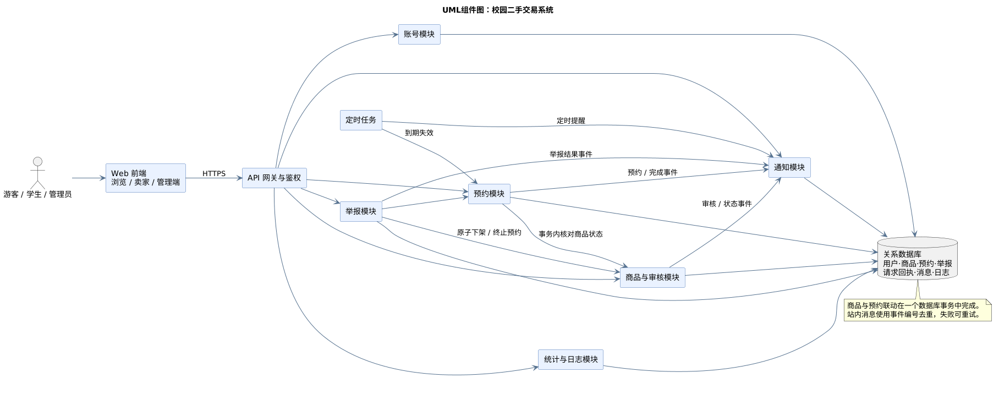{width=90%}

组件图展示前端、鉴权、商品、预约、举报、通知、统计日志和定时任务的关系。预约模块和举报模块都要读取商品的当前状态；通知模块只在业务提交后接收事件，失败重试不回滚已完成的业务变更。对应 REQ-002、008、015、018、020、023。

## 2.2 领域对象与数据关系

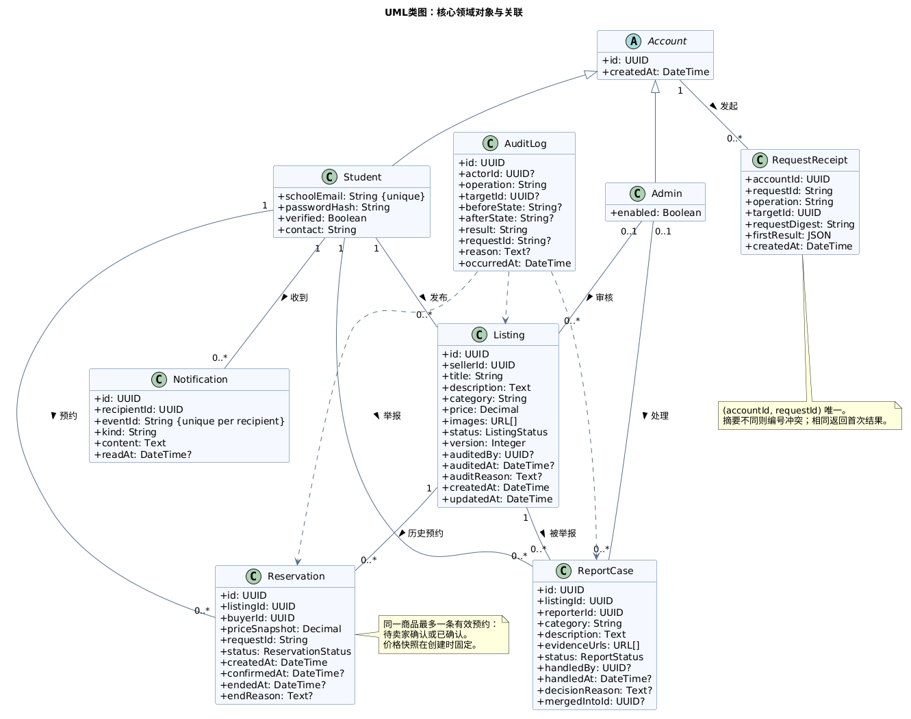{width=95%}

学生和管理员共享账号编号，但权限不同。商品关联卖家；预约关联买家与商品，并记录创建时的价格快照；举报关联举报人、商品和处理管理员。请求回执记录请求摘要与首次结果，解决重复提交；操作日志记录前后状态与结果，供审计。类图表达数据关系，不能单靠图中的多重性保证“最多一条有效预约”，因此还要在数据库和事务边界落实约束。对应 REQ-001、008、009、015、016、018、020。

| 核心实体 | 最重要的字段与约束 | 设计原因 |
|---|---|---|
| 学生账号 | 学校邮箱唯一、验证状态、密码哈希、联系方式 | 身份验证与联系方式都属于非公开数据。 |
| 商品 | 卖家编号、价格、图片、状态、版本、审核信息 | 版本用于识别旧页面提交；发布后修改必须重审。 |
| 预约 | 买家、商品、价格快照、状态、创建/确认/结束时间与原因 | 交易统计按历史成交价，不按后来商品价格。 |
| 请求回执 | 账号、请求编号、操作、目标、参数摘要、首次结果 | 同账号同编号相同内容返回首次结果，内容不同报冲突。 |
| 举报 | 举报人、商品、状态、理由、处理人及合并关联 | 一件商品有多条举报时可追踪合并与失效关闭。 |
| 通知与日志 | 事件编号/收件人；操作人/目标/前后状态/结果 | 消息去重；关键操作追加记录。 |

## 2.3 参与者与功能边界

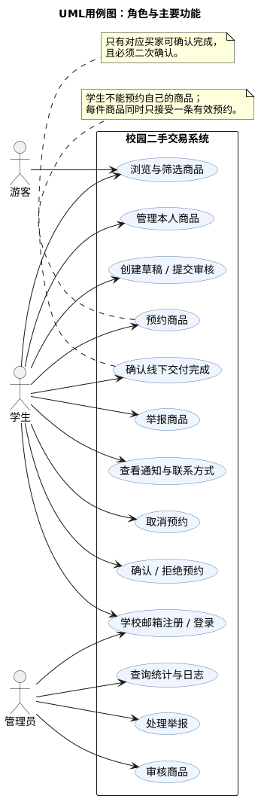{height=20cm}

一个学生账号既能买也能卖，因此用例图用“学生”作为统一参与者，不另设需要切换的买家/卖家账号。管理员只有审核、举报、统计和日志权限，不能代替买家确认线下交付；游客只能浏览公开商品。对应 REQ-001、002、026。

## 2.4 状态规则

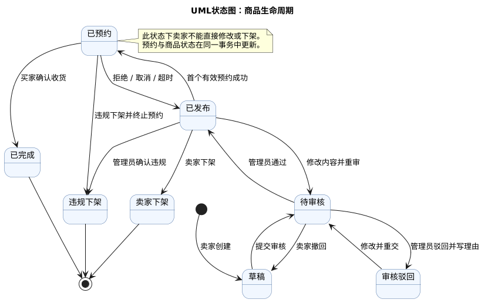{width=86%}

商品已预约时不能直接改内容或下架；预约正常解除才恢复已发布。已完成、卖家下架、违规下架均为终态。待审核商品不公开展示。对应 REQ-003—005、008、014、015。

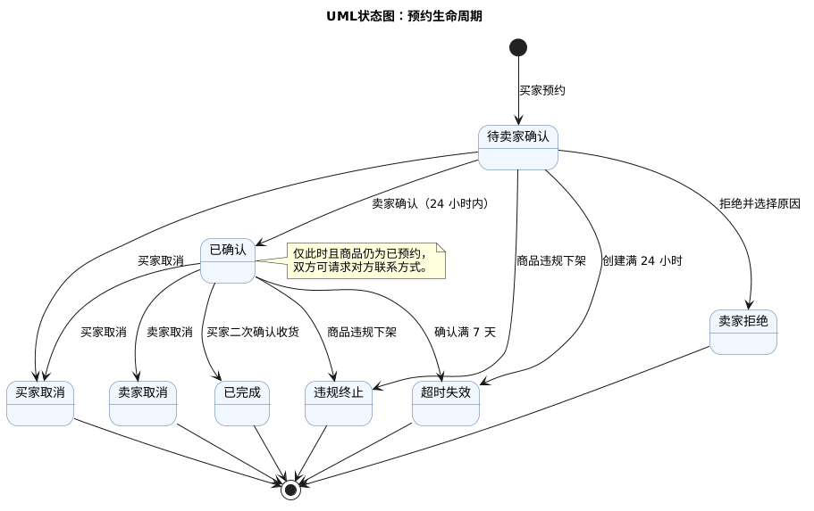{width=88%}

只有“待卖家确认”和“已确认”是有效预约。待确认从创建起 24 小时到期；已确认从确认起 7 天到期，超时只表示预约结束，不表示交易完成。联系方式读取还须同时满足商品仍“已预约”；预约结束后服务端立即停止提供对方联系方式。对应 REQ-011—014、019、024。

## 2.5 关键交互

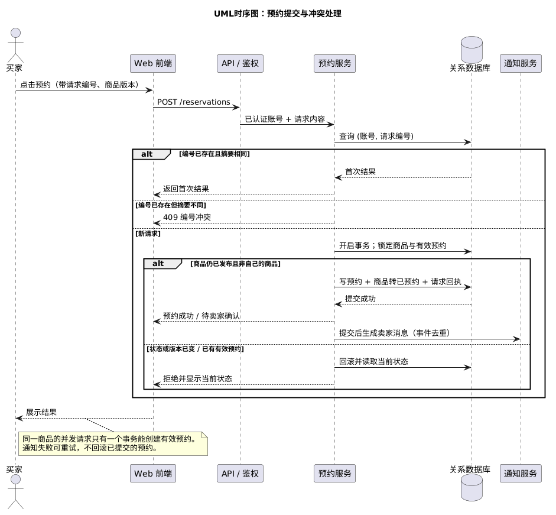{height=16cm}

前端提交请求编号和页面看到的商品版本。服务端先查请求回执：内容完全相同则返回首次结果，编号相同但内容不同则拒绝。新请求进入事务，锁定商品并检查是否已有有效预约；成功时原子写入预约、商品状态和回执，失败时返回最新状态。站内消息在事务成功后生成，并以事件编号去重。对应 REQ-008—010、016、018、023。

## 2.6 跨模块规则检查

| 场景 | 设计处理 | 对应图/界面 |
|---|---|---|
| 两人同时预约 | 商品与有效预约在同一事务里检查和更新，仅一人成功。 | 组件图、时序图；界面 03、06 |
| 旧页面提交 | 校验版本与状态，不覆盖新值；提示用户刷新。 | 时序图；界面 05、09 |
| 同编号不同请求 | `(账号, 请求编号)` 查到不同摘要，拒绝为编号冲突。 | 类图、时序图 |
| 商品完成与违规下架竞争 | 处理前原子核对商品现态；先提交者生效。 | 组件图、状态图；界面 10 |
| 预约终态后查看联系方式 | 每次请求都校验预约和商品状态，历史页不保存联系方式快照。 | 预约状态图；界面 06 |
| 消息任务重试 | 以业务事件编号与收件人去重，不回滚已提交业务。 | 组件图；界面 07 |

# 3 UI 界面设计

本次使用 ReportLab 矢量画布绘制桌面端界面原型，再导出 PNG；绘制源码随界面图一起交付，方便调整。统一采用左侧导航、顶部标题、卡片内容和明确的状态标签。界面只用于验证信息层次与操作路径，不代表已有可运行前端。各功能模块均有对应页面或入口。

| 界面 | 所在模块 / 主要功能 | 关键规则 |
|---|---|---|
| 01 注册登录 | 账号；邮箱验证、设置密码 | 学校域名留作配置项。 |
| 02 商品浏览 | 商品查询；关键词、分类、价格筛选与排序 | 仅展示已发布可预约商品。 |
| 03 商品详情与预约 | 商品、预约；查看详情、预约、举报入口 | 确认前不显示联系方式。 |
| 04 卖家商品管理 | 商品；草稿、审核、发布、下架列表 | 已发布修改要重审，已预约不可直接下架。 |
| 05 卖家处理预约 | 预约；确认或拒绝 | 24 小时内操作，拒绝需选原因。 |
| 06 买家预约详情 | 预约；线下联系、二次确认完成 | 联系方式按现态提供；完成不可撤销。 |
| 07 站内消息 | 通知；业务消息与定时提醒 | 12 小时进度提醒、确认期到期前提醒。 |
| 08 提交举报 | 举报；类别、说明、可选图片 | 重复待处理举报返回原记录。 |
| 09 管理员商品审核 | 商品审核；通过或驳回 | 驳回填写理由，旧页面提交前重新读现态。 |
| 10 管理员举报处理 | 举报处理；驳回或违规下架 | 并发核对、合并同商品举报。 |
| 11 统计与日志 | 统计、日志；成交额、操作查询 | 只计已完成预约；全局日志仅管理员可看。 |

## 3.1 学生端界面

### 界面 01 注册登录

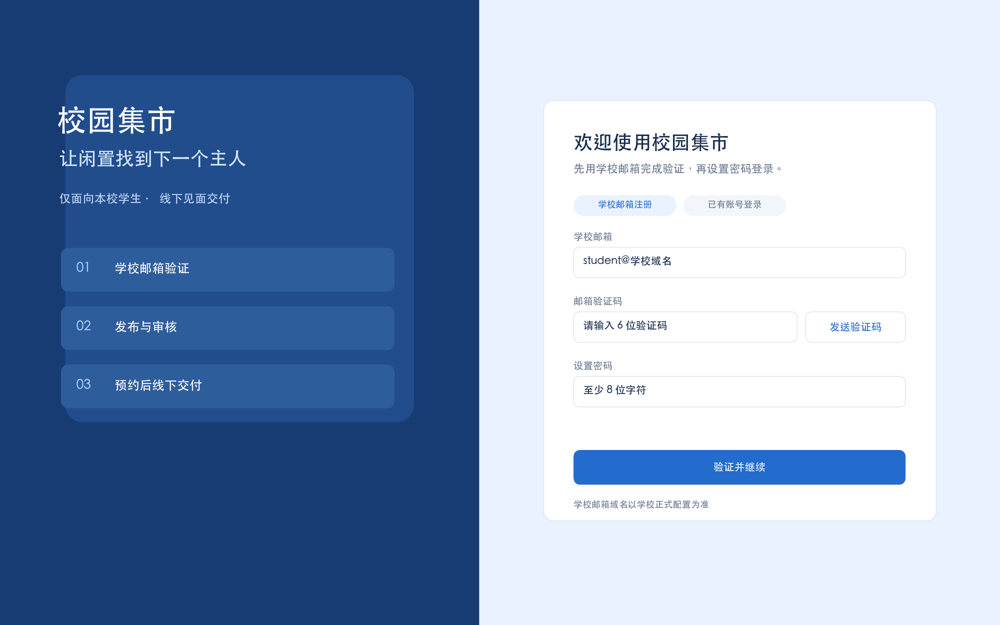{width=88%}

输入学校邮箱并获取验证码，验证后设置密码。真实学校域名尚未确认，原型使用说明文字而不伪造具体域名。

### 界面 02 商品浏览

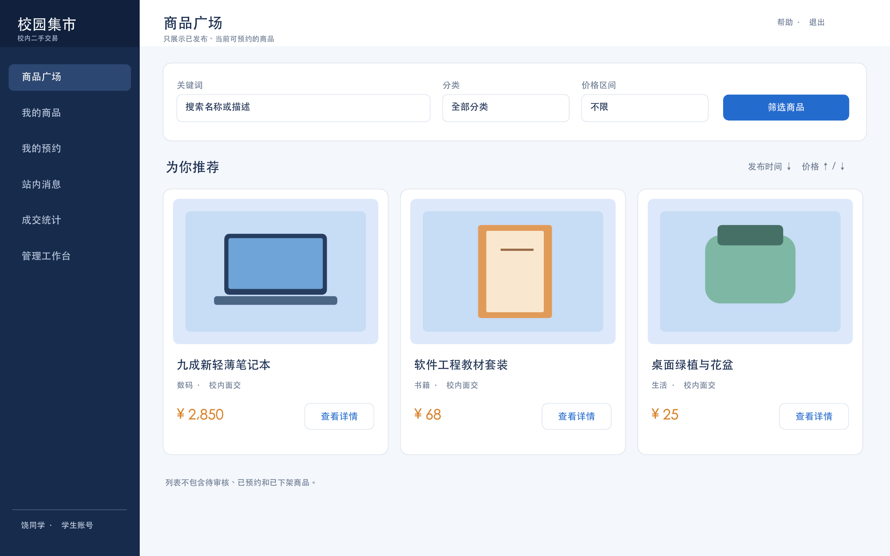{width=88%}

列表组合筛选关键词、分类和价格区间；默认按发布时间倒序。状态已预约、待审核或下架的商品不在公开列表。

### 界面 03 商品详情与预约

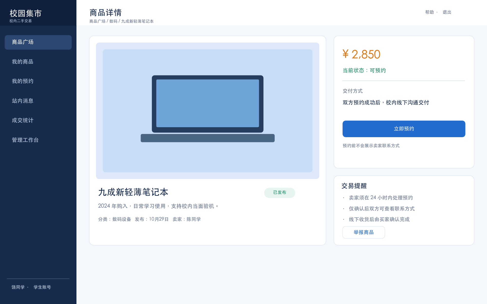{width=88%}

商品详情展示价格、卖家、校内交付说明以及预约按钮。举报作为独立入口；预约前不能读取卖家的联系方式。

### 界面 04 卖家商品管理

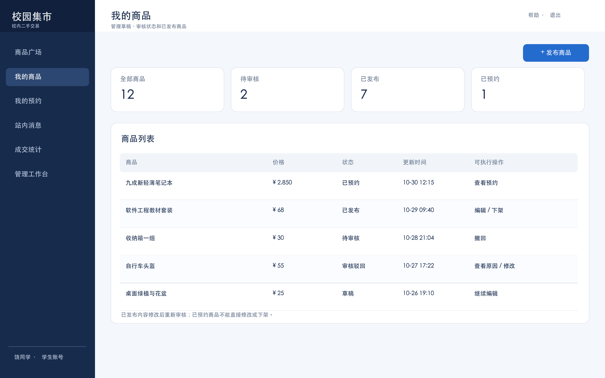{width=88%}

卖家按状态查本人商品；不同状态只显示可执行操作。已发布商品编辑后回到审核，已预约商品不能直接下架。

### 界面 05 卖家处理预约

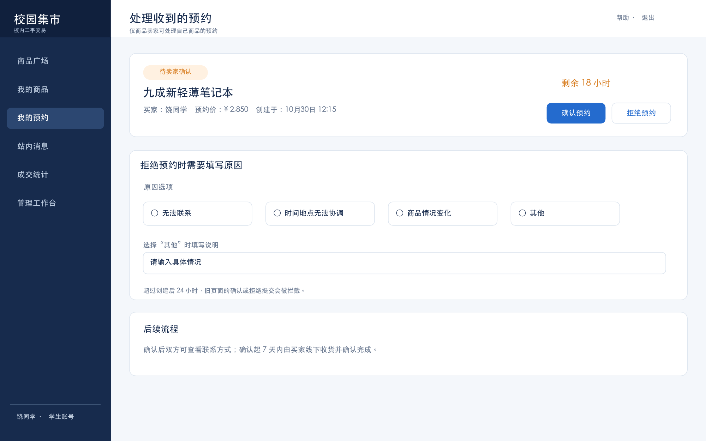{width=88%}

显示预约创建时间、剩余处理时长及确认/拒绝操作。拒绝原因采用固定选项；选“其他”需补充说明。实际提交时服务端再次检查 24 小时期和预约状态。

### 界面 06 买家预约详情

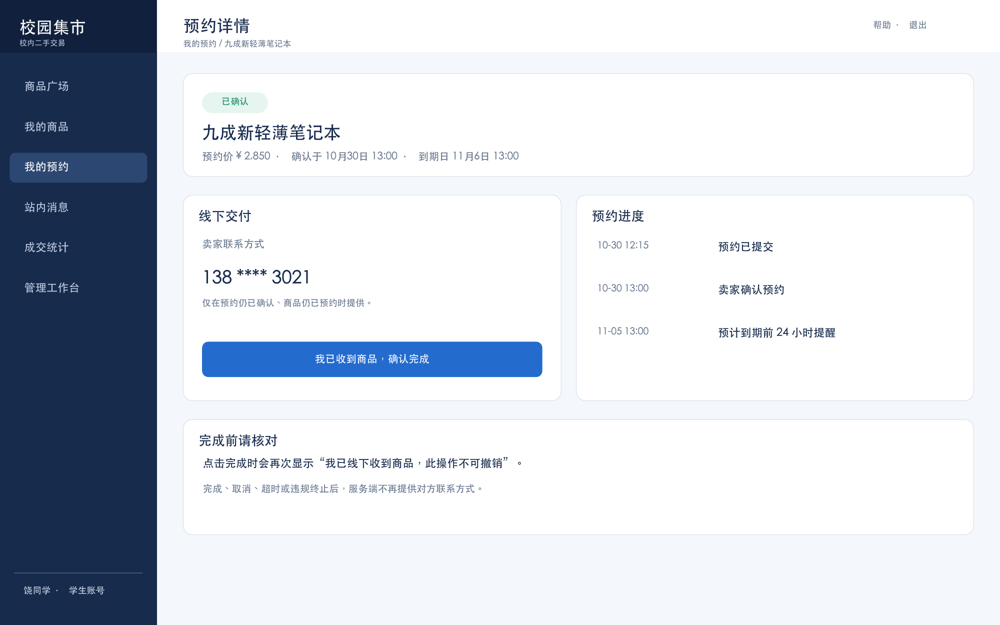{width=88%}

已确认预约可请求对方联系方式，但服务端仍需核对商品“已预约”；终态后刷新即隐藏。完成按钮触发二次确认：“我已线下收到商品，此操作不可撤销”。

### 界面 07 站内消息

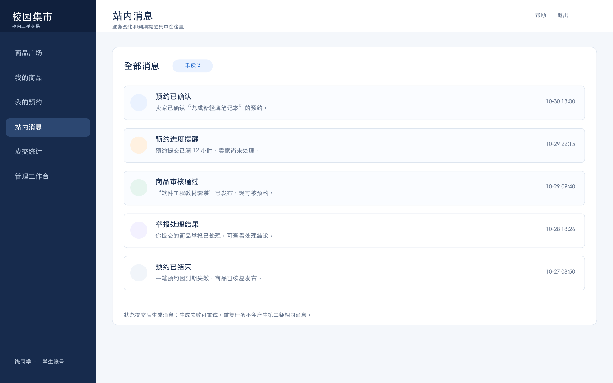{width=88%}

消息列表集中展示审核、预约、举报及到期提醒。待确认满 12 小时仍未处理时给卖家提醒、给买家进度消息；已确认到期前 24 小时且仍有效时提醒双方。

### 界面 08 提交举报

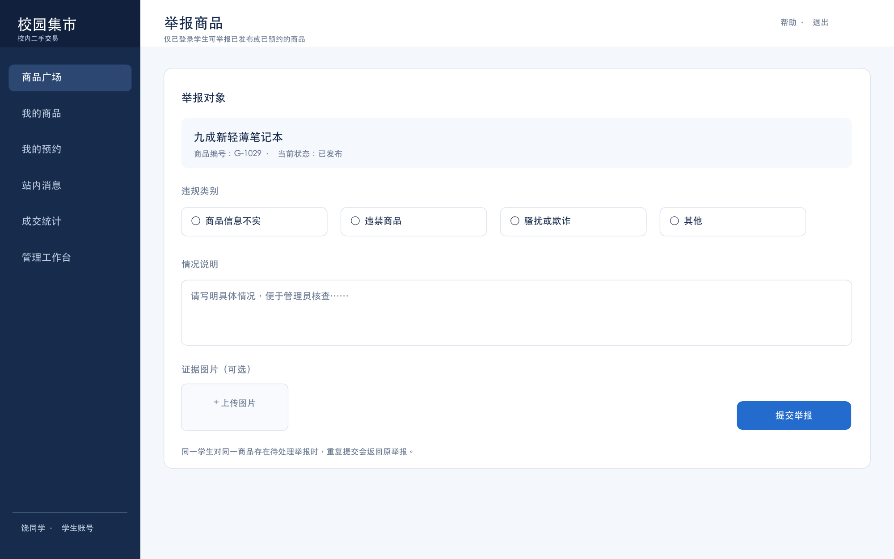{width=88%}

学生选择违规类别、填写说明并可上传证据图片。商品必须仍为已发布或已预约；同一人对同一商品已有待处理举报时，返回原举报。

## 3.2 管理员端界面

### 界面 09 商品审核

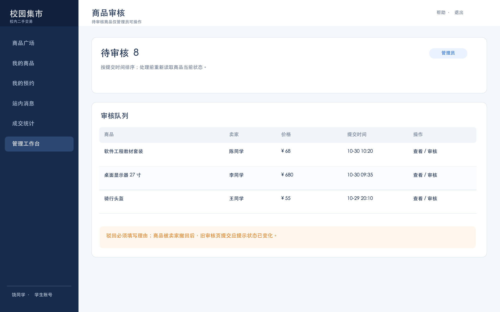{width=88%}

管理员按提交时间处理待审商品。通过发布，驳回必须写理由；若商品已被撤回，旧页面上的审核操作被拒绝。

### 界面 10 举报处理

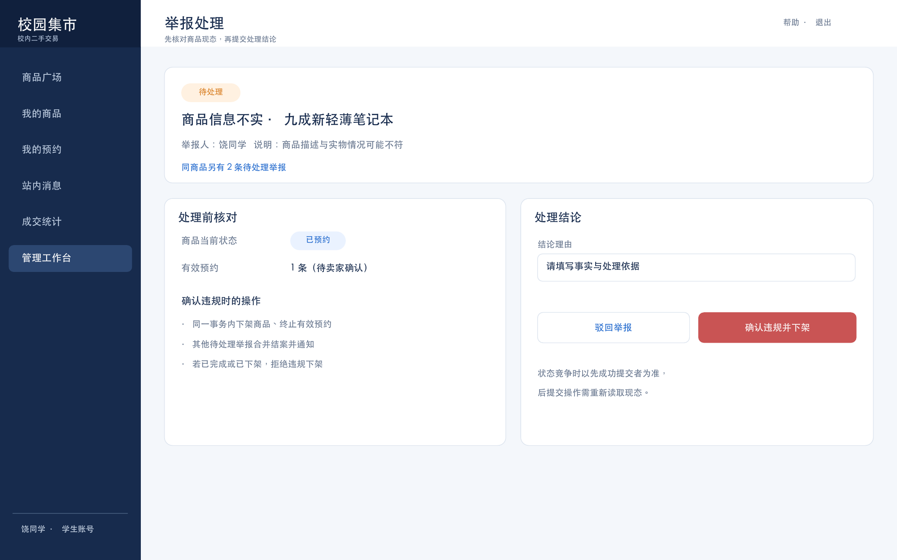{width=88%}

处理页同时显示商品当前状态、有效预约和同商品其他举报。确认违规时事务内下架、终止预约、合并其他待处理举报；若商品已完成或已下架，拒绝该操作并重新读取现态。

### 界面 11 统计与日志

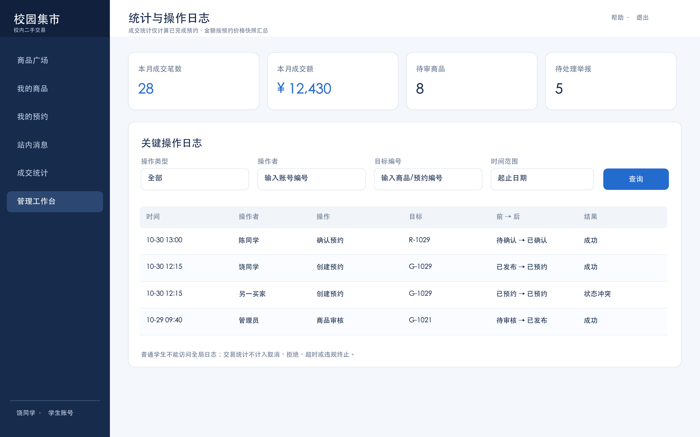{width=88%}

月度成交统计按已完成预约的完成时间和价格快照计算。日志支持按时间、操作者、操作类型、目标编号筛选；普通学生不能进入全局日志页。

# 4 AI 辅助过程与反思

本实验使用 Codex 完成一轮连续的设计协作。以下按实际任务阶段记录，并不把同一会话里的自检写成另一次独立访谈。甲方与乙方的访谈属于实验一的角色模拟；本次没有新增真实用户访谈，也没有声称人已经完成最终审查。交付前仍需本人逐页检查并根据意见修改，届时可再形成明确的人工修改提交。

## 4.1 使用记录

| 阶段与使用场景 | AI 生成结果 | 有用之处与问题 | 核对及优化后的结果 |
|---|---|---|---|
| A. 读实验二要求和实验一需求，整理架构 | 六个业务模块及组件图初稿 | 能快速列全基本模块；容易把模块调用画成独立服务，忽略事务边界。 | 说明第一版可用单体后端中的逻辑模块，商品/预约/举报共享同一事务；通知在提交后异步生成。 |
| B. 把业务规则转成 UML | 类、组件、用例、商品/预约状态、预约时序共六张图的 PlantUML 源码 | 图有助于发现关系缺口；初稿只把请求回执连到学生，漏了管理员变更请求。 | 类图增加 Account 父类，把 Student、Admin 都关联到 RequestReceipt；补充商品审核字段和预约请求编号。 |
| C. 设计各模块界面 | 十一张桌面端界面原型及绘制源码 | 能快速统一导航与视觉样式；演示数据和未来事件容易被误读成真实结果。 | 把预约详情中的未来提醒改为“预计到期前 24 小时提醒”，并在报告说明所有数据均为原型示例。 |
| D. 撰写报告并交叉核对 | 模块说明、图的设计理由、界面功能说明、需求追踪表 | 易于形成完整初稿；文字可能把设计方案说成已实现功能。 | 明确标注“拟采用”“原型”“待确认”，不声称系统已运行、性能已达标或人工审查已完成。 |

记录说明：上述 A—D 是同一次 Codex 协作中可核对的四类实际任务，产物分别为本报告、PlantUML 源码、UI 绘制源码及 PNG。没有逐字保存模型内部生成过程，因此不能把本表当作逐轮对话原文。

## 4.2 设计取舍与工具局限

本次设计采用“先列规则、后画图”的顺序。实验一中最容易出错的规则是并发预约、重复请求、举报状态竞争和联系方式访问条件，因此选择预约时序图与两个状态图，而没有为了凑图种画与业务无关的对象图。UI 页面先按功能模块列清单，再逐页确认是否存在可操作入口和相应状态提示。这一取舍目前由 Codex 提出并自检，仍待本人判断是否符合实际使用场景。

大模型适合把长需求拆为模块、提出类和交互的候选结构、生成可反复修改的 PlantUML 代码，也适合制作统一风格的界面草图。局限是它会补上看似合理、其实未经甲方确认的规则；图能通过渲染也不代表业务正确。它还可能忽略数据库约束、把异步消息画进交易事务，或让界面显示不该泄露的联系方式。本次通过把每个关键设计回指到 REQ 编号、检查终态和竞态，并把待确认参数留空来降低这些问题。

可以形成“需求编号 → AI 生成候选图/界面 → 自动检查语法与文件 → 人检查业务规则 → 修订并提交 Git”的工作流。人可以把大量时间放在检查和决策上，但不能只做文字校对：是否允许某个状态转换、并发时谁生效、哪些信息可见，仍须由人依据原始需求和甲方决定确认。真正的人工审查修改应在 Git 中留下独立记录，不应把 AI 的自检冒充为人工修改。

# 5 交付与后续

本压缩包包含实验报告 PDF、可编辑的 Markdown 版报告、六张 UML PNG 和对应的 `.puml` 源码，以及十一张 UI PNG 和界面绘制源码。源文件与图片成对保留，后续实现时可直接修改图和页面原型。报告中的代码结构、数据库选型及示例页面是设计建议；具体实现可按实验三的技术栈调整。

提交前需要本人重点检查：图 2 的字段和关联、图 4/5 的状态转换、界面 05/06/10 的权限和并发提示，以及报告第 4 章对 AI 使用过程的描述是否符合本人实际操作。完成审查后，再把修改提交到 Git；本报告不会预先声称已发生的人工修改。
